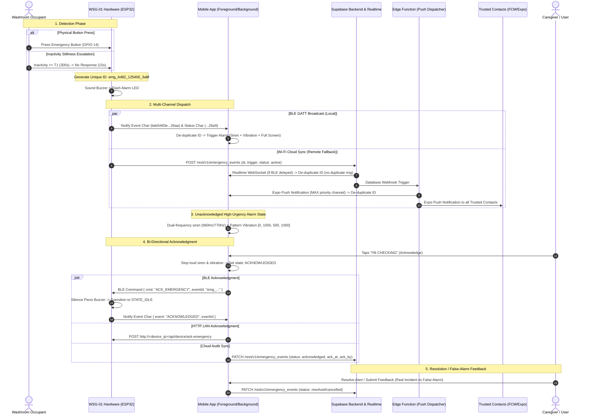
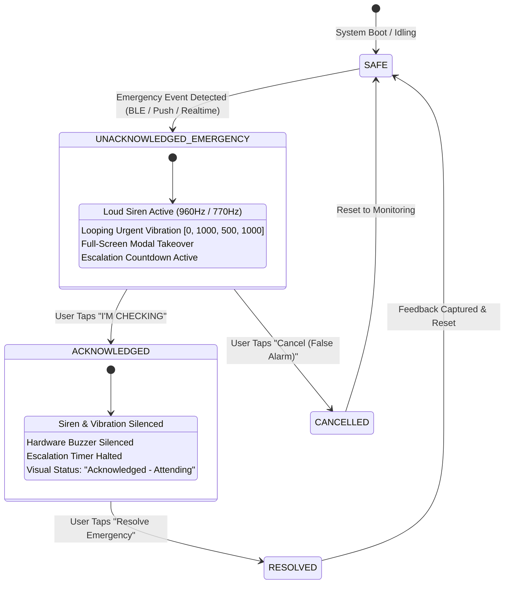

# Dependable End-to-End Emergency Pipeline & Protocol Flow

**Document Version:** 1.0.0  
**Target Hardware:** ESP32-WROOM-32 (Washroom Safety Guardian WSG-01)  
**Target Clients:** Mobile Application (React Native / Expo), Backend (Supabase Postgres & Edge Functions)  
**Applicable Standards:** High-Availability Life-Safety Critical Notification Protocol  

---

## 1. Overview & Core Reliability Principles

The Washroom Safety Guardian (WSG-01) system delivers life-critical emergency detection and alert delivery for vulnerable individuals in private washrooms. Because a single missed emergency could lead to catastrophic outcomes, the system adheres to strict reliability rules:

1. **Hardware-Originated Identity:** Every emergency event is assigned a globally unique ID generated at the hardware source (`emg_<devSuffix>_<millis>_<random>`).
2. **Tri-Channel Ingestion with Idempotent De-duplication:** Emergency signals can arrive via BLE GATT characteristics, Supabase Realtime WebSocket, or Expo Push Notifications (FCM / APNs). The mobile application de-duplicates across all three channels using the unique ID.
3. **Bi-Directional Acknowledgment:** The application maintains a high-urgency unacknowledged emergency state (full-screen takeover, loud sirens, continuous vibration) until the user explicitly acknowledges it ("I'M CHECKING"). Acknowledgment is dispatched back to the hardware device (silencing the buzzer) and persisted to backend audit tables.
4. **Resilient Wi-Fi Fallback (Bluetooth OFF Operation):** If the user's mobile phone is out of BLE range, powered off, or has Bluetooth disabled, the hardware device automatically dispatches the alert over Wi-Fi directly to Supabase REST endpoints, triggering edge function push notifications to all trusted contacts.
5. **Strict Isolation of Offline State vs. Emergency:** Device disconnection, packet loss, or missed heartbeats are flagged as `"device offline / not heard from"` or `"device not responding"`. Missed heartbeats **never** trigger false emergency alarms; emergencies originate solely from verified hardware sensor or button triggers.

---

## 2. End-to-End Sequence Diagram



---

## 3. Unique Emergency ID Generation

### Firmware Format
Emergency IDs are minted by the ESP32 firmware upon the first instant an alarm condition transitions to `STATE_ALARM` or when `sendEmergency()` is invoked:

$$\text{Event ID} = \texttt{emg\_} + \text{DeviceSuffix}_{4} + \texttt{\_} + \text{millis()} + \texttt{\_} + \text{hex}(\text{esp\_random()}_{16})$$

*Example:* `emg_A482_125400_3a8f`

### Consistency Guarantee
Both the BLE notification payload and the Supabase REST HTTPS payload receive the **identical** generated ID:
- **BLE Payload (`pEventLogChar` / `pStatusChar`):**
  ```json
  {
    "type": "EMERGENCY",
    "id": "emg_A482_125400_3a8f",
    "eventId": "emg_A482_125400_3a8f",
    "deviceId": "WSG-01-A482",
    "trigger": "MANUAL_EMERGENCY",
    "status": "ACTIVE",
    "timestamp": 125400
  }
  ```
- **Supabase HTTPS POST (`/rest/v1/emergency_events`):**
  ```json
  {
    "id": "emg_A482_125400_3a8f",
    "device_id": "WSG-01-A482",
    "event_type": "emergency",
    "trigger": "MANUAL_EMERGENCY",
    "status": "active",
    "severity": "critical",
    "source": "manual_device_trigger"
  }
  ```

---

## 4. Multi-Channel De-duplication Protocol

Because emergency signals are concurrently transmitted over BLE, Wi-Fi Realtime, and Push Notifications, the client implements a centralized ring-buffered de-duplication registry in `EmergencyPushService`:

```
                 +--------------------------+
                 | Incoming Emergency Alert |
                 +--------------------------+
                              |
              +---------------+---------------+
              |                               |
       [Channel: BLE]               [Channel: Push / Wi-Fi]
              |                               |
              +---------------+---------------+
                              |
                              v
             +----------------------------------+
             | Is eventId in processedEventIds? |
             +----------------------------------+
                     /                  \
             YES    /                    \    NO
                   v                      v
     +--------------------------+  +--------------------------------+
     | Suppress Duplicate Alert |  | 1. Mark eventId in registry    |
     | Log: "Duplicate ignored" |  | 2. Ring High-Urgency Siren     |
     +--------------------------+  | 3. Continuous Urgent Vibration |
                                   | 4. Present Full-Screen Takeover|
                                   | 5. Start Escalation Countdown  |
                                   +--------------------------------+
```

### De-duplication Matrix
| Scenario | First Arrival | Subsequent Arrivals | Result |
| :--- | :--- | :--- | :--- |
| **Normal Local Operation** | BLE GATT (`< 100ms`) | Realtime WebSocket (`~500ms`), Push (`~1.5s`) | Alarm rings on BLE; Realtime and Push de-duplicated cleanly without audio stutter. |
| **Out of BLE Range** | Wi-Fi Realtime (`~400ms`) | Push Notification (`~1.2s`) | Alarm rings on Realtime; Push de-duplicated. |
| **Phone Locked / App Killed** | Push Notification | BLE reconnection upon app open | Push wakes device; BLE does not re-ring finished alarm. |

---

## 5. Unacknowledged vs. Acknowledged State Machine



---

## 6. Bi-Directional Acknowledgment Details

When the caregiver taps **"I'M CHECKING"**:
1. **Immediate Local Silence:** `EmergencySoundService.acknowledgeAlert()` halts the loud siren and vibration instantly so the caregiver can communicate with the occupant.
2. **Hardware Silencing over BLE:** Application writes `{ "cmd": "ACK_EMERGENCY", "eventId": "<id>" }` to the **COMMAND** characteristic (`beb5483e...26a8`). Firmware shuts off `PIN_BUZZER`, resets `emergencyActive = false`, and notifies `STATE_IDLE`.
3. **Local Wi-Fi HTTP POST Fallback:** If reachable, application POSTs to `http://<device_ip>/api/device/ack-emergency` ensuring buzzer silence even if BLE link dropped.
4. **Cloud Ledger Update:** Application updates Supabase `emergency_events` (`status: 'acknowledged'`, `acknowledged_at: <ISO>`, `acknowledged_by: <user_id>`) and `emergencies` (`status: 'ACKNOWLEDGED'`).

---

## 7. Device Heartbeat & Offline Detection

### Interval & Heartbeat Specification
- **Hardware Cadence:** When connected to Wi-Fi, the firmware dispatches a self-test diagnostic heartbeat payload every **45 seconds** (configurable 30–60s) to `/rest/v1/device_health`:
  ```json
  {
    "device_id": "WSG-01-A482",
    "radar_status": "OK",
    "mic_level": 42,
    "speaker_status": "OK",
    "wifi_status": "CONNECTED",
    "battery_pct": 100,
    "heartbeat_interval_sec": 45,
    "uptime": 1845
  }
  ```
- **Watchdog Timeout Calculation:**
  $$\text{Missed Threshold} = 3 \times \text{heartbeat\_interval\_sec} = 3 \times 45\text{s} = \mathbf{135\text{ seconds}}$$

### Strict Separation of Offline vs. Emergency
- **Never an Emergency:** A missed heartbeat or connection timeout **NEVER** calls `setActiveEmergency()` and never triggers the siren or emergency modal.
- **Visual Presentation:**
  - If disconnected from BLE and no live Wi-Fi: `"Device offline / not heard from"`
  - If 3 heartbeats are missed over Wi-Fi: `"Device not responding"`
- **Maintenance Notification:** Dispatches via the dedicated `device_maintenance` channel (importance: `DEFAULT`, no siren, non-intrusive) and respects Quiet Hours.

---

## 8. Wi-Fi Fallback Verification (Bluetooth OFF)

To verify the Wi-Fi fallback pipeline operates reliably without Bluetooth:

1. **Test Precondition:** Turn phone Bluetooth **OFF** or enable "Fake Bluetooth OFF" in Settings.
2. **Trigger Event:** Press physical hardware emergency button on the ESP32.
3. **Hardware Execution:**
   - ESP32 detects `bleClientConnected == false`.
   - Logs: `[Wi-Fi Fallback] Phone unreachable over BLE! Dispatching emergency via Wi-Fi backend: emg_...`
   - Dispatches HTTPS POST to `/rest/v1/emergency_events`.
4. **Cloud Execution:**
   - Supabase receives event row and triggers `emergency-push-dispatch`.
   - Edge function looks up device push tokens and broadcasts high-priority Expo push notification.
5. **Client Reception:**
   - Phone receives push notification via Android `emergency_alerts` channel (`MAX` importance, bypass DND, lock-screen visibility).
   - Loud alarm and continuous vibration fire.
   - Screen launches directly into full-screen `EmergencyScreen`.

---

## 9. Emergency History Audit Trail

The **History / Events Screen** (`EventsScreen.tsx`) tracks and displays every emergency incident with the five required audit fields:

1. **Time & Date:** Exact timestamp of event detection.
2. **Device:** Unique device ID (e.g., `WSG-01-A482`) and assigned room location.
3. **Trigger:** Hardware cause (`MANUAL_EMERGENCY`, `INACTIVITY_STILLNESS`, `VOICE_KEYWORD`, `TEST_EMERGENCY`).
4. **Acknowledgment:** Timestamp when caregiver tapped "I'M CHECKING", or `Unacknowledged`.
5. **Resolution:** Outcome (`Resolved at <time>`, `Cancelled (False Alarm)`, or `Active Alarm`).
